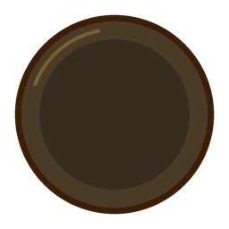
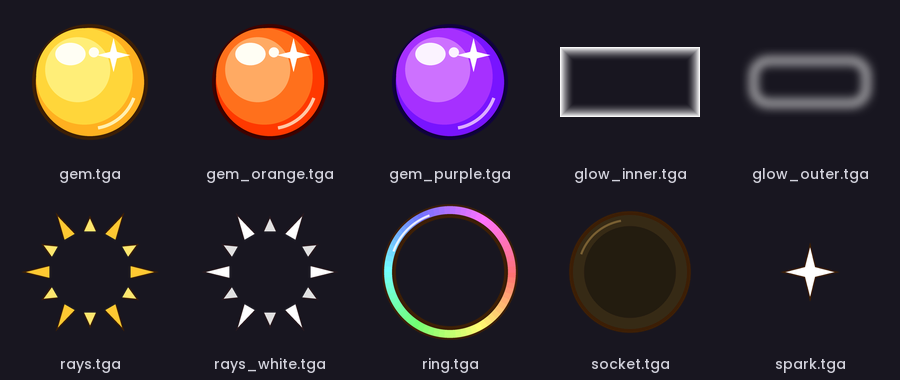
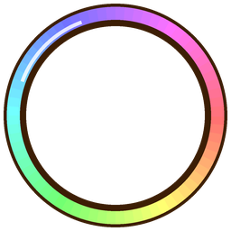
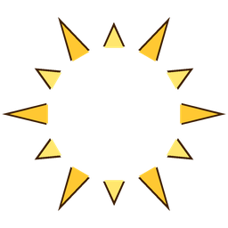
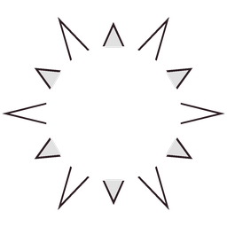

# ☀️ Sunwell Infusion

**Big, bright Infusion of Light charges for Holy Paladin.** With the **Inflorescence of the Sunwell** talent, Infusion of Light can hold **2 charges**. Sunwell Infusion shows them as two glowing sun-gems, so you can see at a glance whether you have one charge or both.

When you gain a charge, its gem lights up with a pop, spinning rays, a rainbow ring, flying sparkles and a little chime. The **1st charge is orange** and the **2nd charge is purple**, so you always know when you're capped.

<p align="center">
  
  &nbsp;&nbsp;
  
  &nbsp;&nbsp;
  
</p>
<p align="center"><em>Empty socket · 1st charge · 2nd charge</em></p>

---

## Features

- **Two sun-gems, one per charge.** Empty sockets when you have no Infusion of Light, an orange gem for one charge, and a purple gem when you have both.
- **Eye-catching gain effect.** Gems pop in with glow, spinning rays, a spinning ring and sparkles.
- **Sparkle chime** when you gain a charge (can be turned off).
- **Works in dungeons, raids and boss fights too.** Where the game hides buffs from addons (Mythic+, raids, encounters), Sunwell Infusion switches to an **engine display**: the game draws Infusion of Light itself and the addon styles it, with a big glowing **"2"** in the second socket when you have both charges. This switch happens automatically.
- **Every source counts.** Judgment, Holy Light and the Season 2 4-piece all grant normal Infusion of Light, so they all show up here.
- **Movable and resizable.** Drag it anywhere and scale it to fit your UI.

## Slash commands

Use `/si` or `/sunwell`.

| Command | What it does |
|---|---|
| `/si` | Show help and the addon version |
| `/si test` | Preview: shows 2 charges, then 1, then clears |
| `/si orbtest` | Preview the dungeon/raid 2nd-charge gem for 4 seconds |
| `/si unlock` | Unlock so you can drag it |
| `/si lock` | Lock it in place |
| `/si scale 1.3` | Resize (0.3 to 3) |
| `/si sound` | Turn the sparkle chime on or off |
| `/si engine auto` | Use the engine display only where buffs are hidden (default) |
| `/si engine on` / `off` | Always or never use the engine display |
| `/si reset` | Reset position, scale and settings |

## Installation

1. Download the latest release from CurseForge (or the **Code → Download ZIP** button here).
2. Copy the `SunwellInfusion` folder into:
   `World of Warcraft/_retail_/Interface/AddOns/`
3. Restart the game (or `/reload`) and type `/si test` to see it.

## Textures

All artwork in the `media` folder, shown here as PNGs (the addon itself uses the `.tga` files):



| | | | | |
|:---:|:---:|:---:|:---:|:---:|
| <br>`gem.tga` | <br>`gem_orange.tga` | <br>`gem_purple.tga` | <br>`socket.tga` | <br>`ring.tga` |
| <br>`rays.tga` | <br>`rays_white.tga` | <br>`glow_inner.tga` | <br>`glow_outer.tga` | <br>`spark.tga` |

## Files

```
SunwellInfusion/
├── SunwellInfusion.toc
├── Core.lua      – sun-gems, effects, settings and slash commands
├── Engine.lua    – engine display for dungeons, raids and boss fights
└── media/        – textures, chime sound and the orb font
```

## Author

Made by Ryan ([rlucas2100](https://github.com/rlucas2100)).
